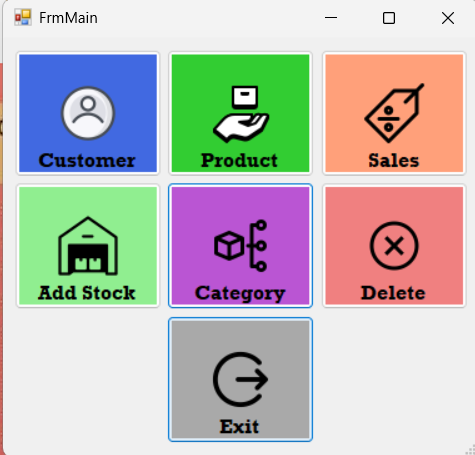
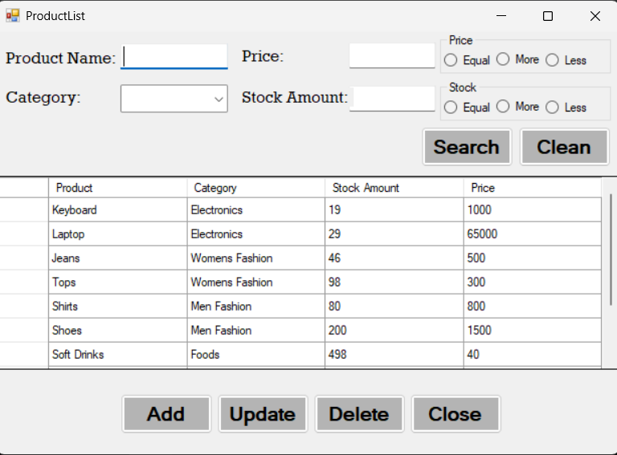
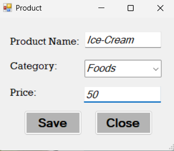
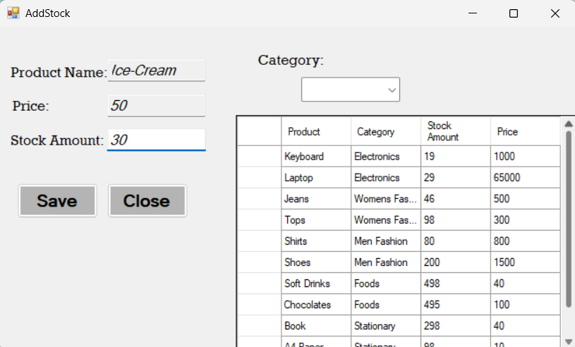
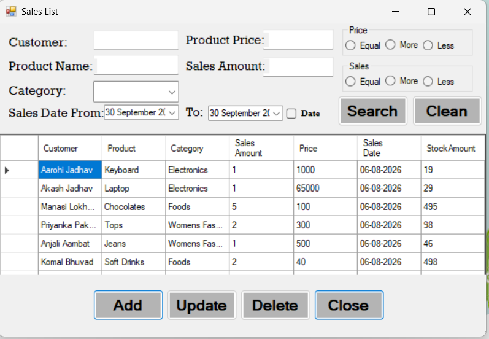
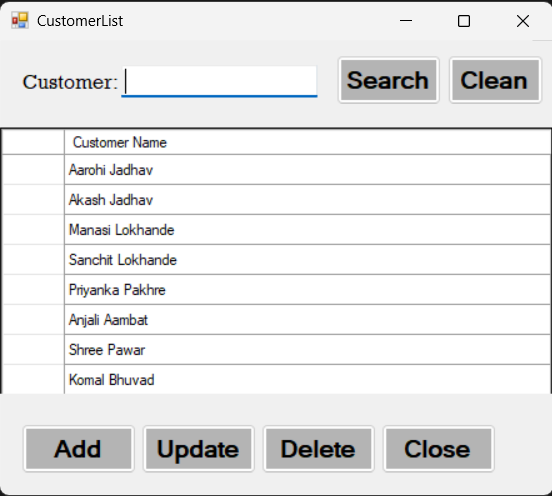

# Stock Tracking System

A desktop-based **Stock Tracking System** developed using **C# Windows Forms**, **Entity Framework**, and **SQL Server**. The application provides modules for managing products, categories, customers, sales, and stock-related information.

## 📌 Project Overview

The Stock Tracking System is designed to simplify inventory management by providing a centralized application for storing, updating, viewing, and managing product and sales-related information.

The project follows a layered architecture using **UI, BLL, DAL, and DTO** components.

## 🛠️ Technologies Used

* C#
* .NET Windows Forms
* SQL Server
* Entity Framework
* LINQ
* DAO / DTO
* N-Tier Architecture

## ✨ Features

### 📦 Product Management

* Add product
* Update product
* Delete product
* View product records
* Search product information
* Manage product details

### 🏷️ Category Management

* Add category
* Update category
* Delete category
* View category records
* Manage products by category

### 👤 Customer Management

* Add customer
* Update customer
* Delete customer
* View customer records
* Manage customer information

### 🛒 Sales Management

* Add sales records
* View sales records
* Manage product sales
* Maintain customer and product information related to sales

### 📊 Stock Management

* Track product stock
* Update stock information
* View current stock records
* Manage stock based on product information

## 🗄️ Database

The application uses **SQL Server** to store and manage stock-related data.

The main database tables include:

* Category
* Product
* Customer
* Sale

The project uses **Entity Framework** for database operations and maintains relationships between related tables.

## 🏗️ Project Architecture

```text
StockTrackingSystem
│
├── UI
│   └── Windows Forms
│
├── BLL
│   └── Business Logic Layer
│
├── DAL
│   └── Data Access Layer
│
└── DTO
    └── Data Transfer Objects
```

### Layer Responsibilities

**UI (User Interface)**
Handles forms, user input, buttons, data grids, and displaying information.

**BLL (Business Logic Layer)**
Handles the business logic between the user interface and data access layers.

**DAL (Data Access Layer)**
Handles database operations and communication with SQL Server using Entity Framework.

**DTO (Data Transfer Object)**
Transfers data between different layers of the application.

## 🖥️ Application Screenshots

### Main Screen



### Product List



### Product Form



### Stock Management



### Sales List



### Customer List



## 🚀 How to Run

### Prerequisites

* Visual Studio
* .NET Framework compatible with the project
* SQL Server
* SQL Server Management Studio (SSMS)

### Steps

1. Clone the repository.
2. Open the solution in Visual Studio.
3. Create or import the required SQL Server database.
4. Update the database connection string according to your SQL Server configuration.
5. Build the solution.
6. Run the application.

## 🎯 Learning Outcomes

Through this project, I gained practical experience in:

* C# Windows Forms development
* SQL Server database integration
* Entity Framework
* CRUD operations
* N-Tier architecture
* DAO and DTO
* LINQ
* Database relationships
* Product and stock management
* Customer and sales management
* Debugging and troubleshooting

## 👩‍💻 Developer

**Manasi Lokhande**

B.Sc. Information Technology

GitHub: [manasi-lokhande](https://github.com/manasi-lokhande)

---

⭐ Thank you for visiting this project!
